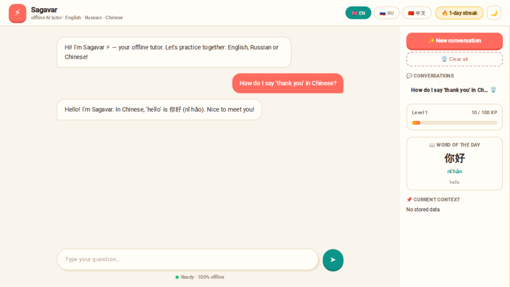

# ⚡ Sagavar — Offline Language Tutor

**An AI language tutor for English, Russian and Chinese that runs entirely on your computer.**
No internet. No account. No data leaving your device.

---

## ✨ Why Sagavar

- **🌍 Truly offline** — after the one-time download, everything runs locally. Perfect for low-connectivity regions, travel and privacy.
- **🤖 Works with Ollama & KoboldCpp** — auto-detects your setup! If you already have Ollama running, Sagavar will use it. Otherwise, it falls back to KoboldCpp.
- **🔧 Runs on old hardware** — any PC with 4 GB RAM. The AI (Qwen 2.5 1.5B quantized) runs on the CPU.
- **🇬🇧🇷🇺🇨🇳 Three languages, one tutor** — English, Russian and Chinese, with pinyin for Chinese and automatic replies in the language you write in.
- **🔒 Privacy by design** — conversations are saved only in your browser's local storage. No server, no telemetry, no tracking.
- **🎓 A tutor, not just a chat** — friendly interface with a daily streak, XP levels and a word of the day, all computed locally from your real activity.
- **💻 No installation** — download, double-click, chat. Responses stream token-by-token, so you start reading immediately even on slow CPUs.

## 🚀 Quick start

**Requirements:** Linux (Simply Linux / ALT Linux, Ubuntu, Debian…), 4 GB RAM (8 GB recommended), ~5 GB disk, Python 3 and `wget` (usually pre-installed).

1. **Download the latest release** `Sagavar-v2.1.0.zip` from the [Releases page](https://github.com/danilo-labs/Sagavar/releases/latest) and extract it.
2. Right-click `avvia_sagavar.sh` → **Properties → Permissions → "Allow executing file as program"**.
3. Double-click it (choose **"Run in Terminal"**). 
   *   *If you already have Ollama installed and running, Sagavar will detect it instantly.*
   *   *If not, it will download KoboldCpp + the model on the first run.*
4. The launcher waits for the model to load, then opens your browser automatically. Chat away!
5. **To quit:** press `ENTER` in the terminal (or close it). All processes are stopped cleanly.

> If the browser doesn't open: go to <http://127.0.0.1:8100/sagavar.html>

## 🛠 Troubleshooting

- **Python not found** → `sudo apt install python3`
- **"manca koboldcpp…" / model errors** → make sure both downloaded files are in the `Sagavar` folder and the filenames match exactly; details in `kobold.log`
- **Slow start** → on old PCs the model takes up to ~1 minute to load; the launcher shows how long it waited
- **Port already in use** → a previous Sagavar is still running; the launcher reuses it automatically

## ⚠️ Known limitations (we're honest about these)

- The quantized 1.5B model can make mistakes in advanced Russian grammar and Chinese idioms.
- For complex questions (proverbs, subtle grammar differences) it may answer imprecisely or ask you to rephrase.
- Best used for: conversation practice, basic translations and vocabulary.

## 🗺 Roadmap

- [x] Streaming responses (token-by-token)
- [x] Robust launcher: waits for the model, cleans up processes on exit
- [x] Friendly "Campus" UI with real streak, XP and word of the day
- [x] Auto-detect support for Ollama and KoboldCpp
- [ ] Lesson engine: structured CEFR A1–B1 lessons (JSON packs)
- [ ] Spaced repetition (FSRS) for vocabulary
- [ ] Newer default model (Qwen3-1.7B) and an 8 GB "Plus" profile (Qwen3-4B)
- [ ] Windows support

## 📦 Credits

- [Ollama](https://ollama.com/) — modern local AI server
- [KoboldCpp](https://github.com/LostRuins/koboldcpp) — lightweight local AI server
- [Qwen2.5-1.5B-Instruct](https://huggingface.co/bartowski/Qwen2.5-1.5B-Instruct-GGUF) (GGUF by bartowski) — the language model
- The UI is a single HTML file with no dependencies.

## 📄 License

MIT — free to use, study, modify and share.

---

# 🇷🇺 Русская версия

## Почему Sagavar

- **🌍 Полностью офлайн** — после первой загрузки всё работает локально.
- **🤖 Поддержка Ollama и KoboldCpp** — автоматическое определение! Если у вас уже запущен Ollama, Sagavar будет использовать его. В противном случае — KoboldCpp.
- **🔧 Работает на старом железе** — любой ПК с 4 ГБ ОЗУ.
- **🇬🇧🇷🇺🇨🇳 Три языка** — английский, русский и китайский (с пиньинем).
- **💻 Без установки** — скачал, запустил, общаешься.

## Быстрый старт

1. **Скачайте последний релиз** `Sagavar-v2.1.0.zip` со [страницы релизов](https://github.com/danilo-labs/Sagavar/releases/latest) и распакуйте.
2. Правой кнопкой по `avvia_sagavar.sh` → Свойства → Права → «Разрешить запуск».
3. Двойной клик → «Запустить в терминале». Лаунчер дождётся загрузки модели и сам откроет браузер.
4. **Выход**: нажмите `ENTER` в терминале.

> Если браузер не открылся: <http://127.0.0.1:8100/sagavar.html>

---

# 🇨🇳 中文版

## 为什么选择 Sagavar

- **🌍 完全离线** — 首次下载后全部本地运行。
- **🤖 支持 Ollama 和 KoboldCpp** — 自动检测！如果您已运行 Ollama，Sagavar 会自动使用它。否则回退到 KoboldCpp。
- **🔧 老电脑也能跑** — 4 GB 内存即可。
- **🇬🇧🇷🇺🇨🇳 三种语言** — 英语、俄语、中文（附拼音）。
- **💻 无需安装** — 下载、双击、开始聊天。

## 快速开始

1. 从 [Releases 页面](https://github.com/danilo-labs/Sagavar/releases/latest) 下载最新的 `Sagavar-v2.1.0.zip` 压缩包并解压。
2. 右键 `avvia_sagavar.sh` → 属性 → 权限 → 勾选"允许作为程序执行"。
3. 双击运行（选"在终端中运行"），启动器会自动打开浏览器。

> 如果浏览器没有打开：<http://127.0.0.1:8100/sagavar.html>